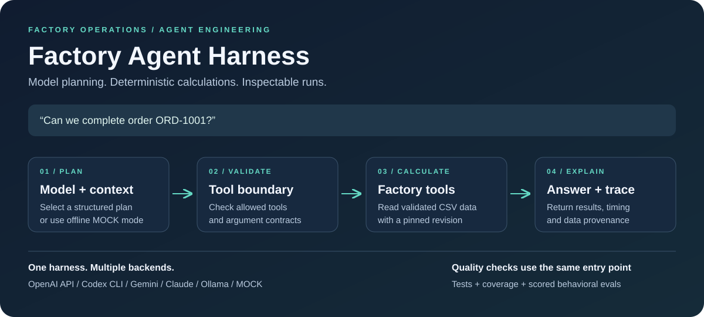
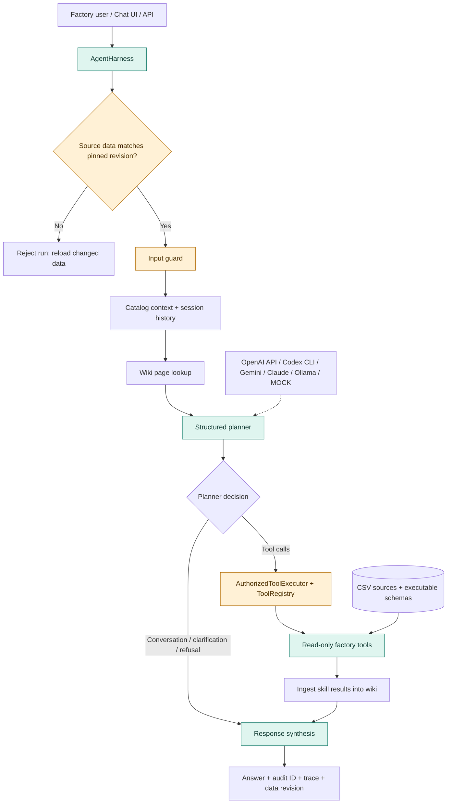
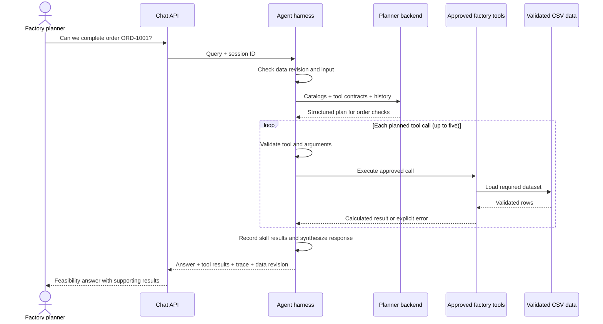
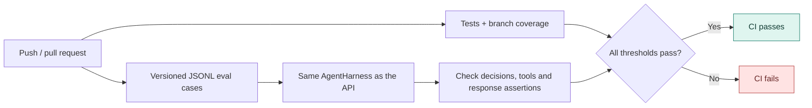

# Factory Agent Harness

[](https://github.com/Jayaragul/AGENT-HARNESS/actions/workflows/ci.yml)



A small, inspectable AI agent for factory operations. Ask about an order, inventory, material shortages, or machine requirements. The agent selects tools, Python computes the results, and the response includes the tool outputs and a run trace.

The central idea is simple: let the model choose what to check; make the checks explicit. The harness is the code around the model that validates inputs, controls tool execution, records evidence, and makes behavior testable.

This repository includes a FastAPI app, a chat UI, CSV factory data, interchangeable model backends, and an offline evaluation suite. It is a working engineering prototype with specific limits, described below.

## Start here

Use Python 3.11. From the repository root:

```bash
cd factory-agent
python -m venv .venv
```

Activate the environment and install dependencies:

```powershell
# Windows PowerShell
.venv\Scripts\Activate.ps1
pip install -r requirements.txt
Copy-Item .env.example .env
```

```bash
# macOS / Linux
source .venv/bin/activate
pip install -r requirements.txt
cp .env.example .env
```

Set `BACKEND=MOCK` in `.env` for a repeatable first run without credentials. The supplied example otherwise defaults to `CODEX_CLI`.

```bash
uvicorn web_app:app --host 127.0.0.1 --port 8000
```

Open [localhost:8000](http://localhost:8000). Try:

- `Do we have enough material for order ORD-1001?`
- `What machines are needed for order ORD-1002?`
- `Generate a material risk report.`

`MOCK` uses deterministic planning rules. To try model-driven planning, select a backend from the table below.

## What happens in a run?

1. **Check the input and data.** Pin the source revision and validate the query.
2. **Build context.** Load catalog descriptions and session history; look up relevant wiki page references.
3. **Plan.** Produce a structured decision: call tools, answer a conversational query, ask for clarification, or refuse.
4. **Execute.** Check tool authorization and argument contracts, then run up to five sequential calls over validated data.
5. **Return evidence.** Synthesize the response and attach tool results, an `audit_id`, stage timings, and the data revision. Skill results are also recorded in the wiki.

## Architecture



The evaluation harness invokes the same `AgentHarness` used by the API. It does not bypass routing or call skill functions directly.

The wiki lookup records relevant page references; the planner currently receives catalog context and session history. Factory facts and calculations come from the approved data tools.

## From question to evidence

This example shows how an order question becomes a verifiable answer. The actual values depend on the loaded factory data.



## Measure it

Run these from `factory-agent/` with the environment activated:

```bash
pytest --cov --cov-report=term-missing
python -m evals.runner --min-score 0.95 --min-pass-rate 0.90
```

The most recently recorded local results, using Python 3.11 and the deterministic `MOCK` backend:

| Signal | Result |
|---|---:|
| Unit/integration/eval tests | 97 passed |
| Branch coverage | 78.49% (75% gate) |
| Behavioral eval cases | 14/14 passed |
| Behavioral score | 100% |
| Eval categories | task success, routing, orchestration, robustness, safety |

These results describe the included regression suite. Fourteen passing cases do not establish reliability on arbitrary factory questions or measure the live backends. Run each configured model against the same cases to see where its behavior differs.



CI requires passing tests, at least **75% branch coverage**, a behavioral score of at least **95%**, and an eval case pass rate of at least **90%**. The diagram shows the checks conceptually; the workflow runs them in sequence.

Each [JSONL case](factory-agent/evals/cases/core.jsonl) can check the selected skill, planner decision, ordered tool calls, and response fields. Assertions include `equals`, `contains`, and `greater_than`. Reports go to `factory-agent/eval_reports/latest.json` and `latest.md` (ignored by Git). A failed threshold returns a nonzero exit code.

## Choose a backend

Set `BACKEND` in `.env`. Model names and optional settings are in [.env.example](factory-agent/.env.example).

| Backend | Connection | Required setup |
|---|---|---|
| `MOCK` | Local deterministic rules | No credentials or model server |
| `CODEX` | OpenAI API | `OPENAI_API_KEY` |
| `CODEX_CLI` | Locally installed Codex CLI | CLI installed and signed in |
| `GEMINI` | Gemini API | `GEMINI_API_KEY` |
| `CLAUDE` | Anthropic API | `ANTHROPIC_API_KEY` |
| `OLLAMA` | Local Ollama server | Server running with `OLLAMA_MODEL` pulled |

For Ollama, pull the model configured in `.env`, for example `ollama pull qwen3.5:9b`, then start the app with `BACKEND=OLLAMA`.

`CODEX_CLI` uses the account signed in on this computer. Each backend call starts a fresh ephemeral Codex run in a temporary directory with read-only sandboxing. It uses the account's available Codex usage; it does not share an existing chat session.

To evaluate a live backend:

```bash
python -m evals.runner --backend OLLAMA
# Replace OLLAMA with CODEX, CODEX_CLI, GEMINI, or CLAUDE as needed.
```

## API and data provenance

| Endpoint | Purpose |
|---|---|
| `GET /api/health` | Service readiness, active backend, and pinned data revision |
| `POST /api/chat` | Run an agent query |
| `GET /api/tools` | Inspect the approved tool surface |
| `GET /api/dashboard` | Factory snapshot KPIs |

The health and chat responses, plus each run trace, include a `data_revision` identifier. It changes
when any configured CSV bytes or the canonical schema contract changes. The
identifier contains hashes and dataset names only, not factory rows. It is a
provenance check, not a backup or rollback system; retain private source-data
snapshots in the factory's approved storage.

Example:

```bash
curl -X POST http://localhost:8000/api/chat \
  -H "Content-Type: application/json" \
  -d '{"query":"Can we complete order ORD-1001?"}'
```

## Read the code

Start with [harness.py](factory-agent/agent/harness.py) to follow one request. Then read [llm_first_planner.py](factory-agent/agent/llm_first_planner.py) for planning, [tool_executor.py](factory-agent/agent/tool_executor.py) and [tool_registry.py](factory-agent/agent/tool_registry.py) for execution boundaries, and [evals/runner.py](factory-agent/evals/runner.py) for scoring.

```text
factory-agent/
├── agent/                 # Planner, harness, sessions, trace, wiki
├── data_access/           # CSV loading and schema validation
├── evals/                 # JSONL cases, scoring, JSON/Markdown reports
├── guardrails/            # Input, data, output, and path protections
├── models/                # OpenAI API, local Codex CLI, Gemini, Claude, Ollama, and deterministic mock backends
├── skills/                # Domain skill contracts and handlers
├── tools/                 # Deterministic business calculations
├── tests/                 # Unit, integration, API, trace, and eval tests
├── static/                # Chat UI
└── web_app.py             # FastAPI application
```

See [Agent Foundation](docs/AGENT_FOUNDATION.md) for the adapted architecture map, design decisions, known limits, and staged engineering roadmap.

## Limits and next steps

- CSV is appropriate for the included reproducible dataset; a production deployment should replace it with a transactional source and explicit freshness SLAs.
- Sessions and wiki state are process-local/file-backed. Horizontal deployment would move these to durable shared storage.
- Tool execution is sequential and capped at five calls. Parallel execution is possible for independent read-only tools, but needs trace and failure semantics first.
- Live model evals can vary and incur cost. CI therefore uses deterministic `MOCK` mode; live runs are a separate release check.
- The agent is intentionally read-only. Proposed factory changes should go through an approval workflow rather than silently mutating operational data.

To adapt this to a factory, begin with its data: map the source columns to the executable schemas, update the catalogs, and add eval cases for questions with known answers. Run those cases before connecting a live model. The useful next improvements are broader factory-specific eval coverage, recorded live-backend comparisons, and durable session storage.
