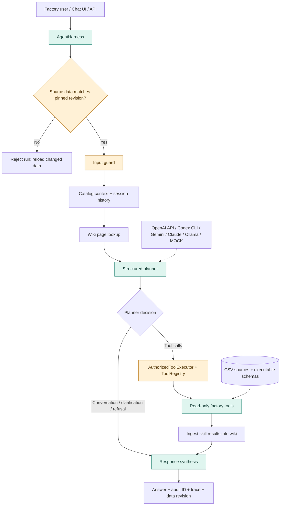
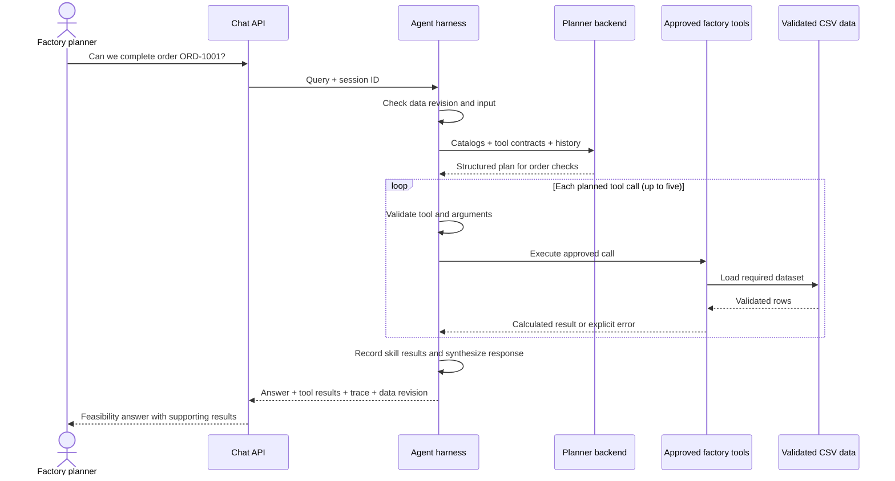
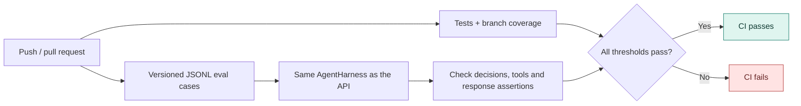

# Factory Agent Harness

[](https://github.com/Jayaragul/AGENT-HARNESS/actions/workflows/ci.yml)


A production-shaped AI agent for factory operations. It turns natural-language requests into validated, read-only tool calls over factory data, preserves a trace for every run, and ships with a scored behavioral evaluation harness rather than relying on demo prompts.

The project is deliberately hybrid: an LLM can plan and explain, while deterministic Python tools own calculations and business facts. `MOCK` mode follows the same harness without an API key, making regression tests and CI repeatable.

## What this demonstrates

- Agent orchestration: guard → retrieve context → plan → execute tools → synthesize.
- Structured tool boundaries with allowlisting, required-argument checks, type checks, identifier normalization, and bounded query limits.
- Grounded factory skills for material sufficiency, machine requirements, and portfolio-wide material risk.
- Multi-tool planning for order feasibility and session-aware follow-up questions.
- Per-run observability with a correlated `audit_id`, stage timing, tool arguments, status, and total latency.
- A content-derived data revision that fingerprints CSV sources and their executable schemas, is returned by health/chat APIs, and rejects mid-process data drift.
- Persistent wiki ingestion isolated from tests and evals.
- Offline behavioral evals plus optional model evals for OpenAI API, local Codex CLI, Gemini, Claude, or local Ollama backends.
- A CI quality gate covering tests, branch coverage, and behavioral score thresholds.

## Architecture



The evaluation harness invokes the same `AgentHarness` used by the API. It does not bypass routing or call skill functions directly.

The wiki lookup records relevant page references; the planner currently receives catalog context and session history. Factory facts and calculations come from the approved data tools.

## From question to evidence

This example shows how an order question becomes a verifiable answer. The actual values depend on the loaded factory data.



## Current quality gate

Verified locally on Python 3.11:

| Signal | Result |
|---|---:|
| Unit/integration/eval tests | 97 passed |
| Branch coverage | 78.49% (75% gate) |
| Behavioral eval cases | 14/14 passed |
| Behavioral score | 100% |
| Eval categories | task success, routing, orchestration, robustness, safety |

`MOCK` scores are deterministic regression results, not a claim about a live model's general intelligence. Use `--backend CODEX`, `--backend CODEX_CLI`, `--backend GEMINI`, `--backend CLAUDE`, or `--backend OLLAMA` to measure a configured model against the same cases.



CI requires passing tests, at least **75% branch coverage**, a behavioral score of at least **95%**, and an eval case pass rate of at least **90%**. The diagram shows the checks conceptually; the workflow runs them in sequence.

## Quick start

```bash
cd factory-agent
python -m venv .venv
# Windows: .venv\Scripts\activate
# macOS/Linux: source .venv/bin/activate
pip install -r requirements.txt
copy .env.example .env  # use cp on macOS/Linux
```

For a keyless local run, set `BACKEND=MOCK` in `.env`, then:

```bash
uvicorn web_app:app --host 0.0.0.0 --port 8000
```

For a local model run, start Ollama, pull the configured model, and set `BACKEND=OLLAMA`:

```bash
ollama pull qwen3.5:9b
uvicorn web_app:app --host 0.0.0.0 --port 8000
```

The example setup uses the Codex account signed in with the local Codex CLI.
Install/sign in to Codex CLI first; no `OPENAI_API_KEY` is needed. Each request
starts a fresh ephemeral Codex run in a temporary working
directory with read-only sandboxing. This is a separate Codex run, not this
ChatGPT conversation, and it uses the account's available Codex usage.

Open `http://localhost:8000`. Useful endpoints:

| Endpoint | Purpose |
|---|---|
| `GET /api/health` | Service readiness, active backend, and pinned data revision |
| `POST /api/chat` | Run an agent query |
| `GET /api/tools` | Inspect the approved tool surface |
| `GET /api/dashboard` | Factory snapshot KPIs |

The health and chat responses, plus each run trace, include a `data_revision` identifier. It changes
when any configured CSV bytes or the canonical schema contract changes. The
identifier contains hashes and dataset names only, not factory rows. It is a
provenance check, not a backup or rollback system; retain private source-data
snapshots in the factory's approved storage.

Example:

```bash
curl -X POST http://localhost:8000/api/chat \
  -H "Content-Type: application/json" \
  -d '{"query":"Can we complete order ORD-1001?"}'
```

## Run the quality gates

```bash
cd factory-agent
pytest --cov --cov-report=term-missing
python -m evals.runner --min-score 0.95 --min-pass-rate 0.90
```

Reports are written to `factory-agent/eval_reports/latest.json` and `latest.md` and are intentionally ignored by Git.

Run the same eval set against a live backend:

```bash
# Requires OPENAI_API_KEY
python -m evals.runner --backend CODEX

# Requires local Codex CLI installed and signed in
python -m evals.runner --backend CODEX_CLI

# Requires GEMINI_API_KEY
python -m evals.runner --backend GEMINI

# Requires ANTHROPIC_API_KEY
python -m evals.runner --backend CLAUDE

# Requires Ollama running locally and the model pulled (ollama pull qwen3.5:9b)
python -m evals.runner --backend OLLAMA
```

Each JSONL case can assert the selected skill, planner decision, ordered tool calls, and arbitrary response paths with operators such as `equals`, `contains`, and `greater_than`. A failed threshold returns a non-zero exit code for CI.

## Repository map

```text
factory-agent/
├── agent/                 # Planner, harness, sessions, trace, wiki
├── data_access/           # CSV loading and schema validation
├── evals/                 # JSONL cases, scoring, JSON/Markdown reports
├── guardrails/            # Input, data, output, and path protections
├── models/                # OpenAI API, local Codex CLI, Gemini, Claude, Ollama, and deterministic mock backends
├── skills/                # Domain skill contracts and handlers
├── tools/                 # Deterministic business calculations
├── tests/                 # Unit, integration, API, trace, and eval tests
├── static/                # Chat UI
└── web_app.py             # FastAPI application
```

See [Agent Foundation](docs/AGENT_FOUNDATION.md) for the adapted architecture map, design decisions, known limits, and staged engineering roadmap.

## Engineering choices and limits

- CSV is appropriate for the included reproducible dataset; a production deployment should replace it with a transactional source and explicit freshness SLAs.
- Sessions and wiki state are process-local/file-backed. Horizontal deployment would move these to durable shared storage.
- Tool execution is sequential and capped at five calls. Parallel execution is possible for independent read-only tools, but needs trace and failure semantics first.
- Live model evals can vary and incur cost. CI therefore uses deterministic `MOCK` mode; live runs are a separate release check.
- The agent is intentionally read-only. Proposed factory changes should go through an approval workflow rather than silently mutating operational data.

## Interview walkthrough

Start with `agent/harness.py`, then `agent/llm_first_planner.py`, `agent/tool_registry.py`, and `evals/runner.py`. The strongest story is not “the model answers questions”; it is that model behavior is constrained by deterministic tools, every run is inspectable, and regressions fail a measurable gate.
