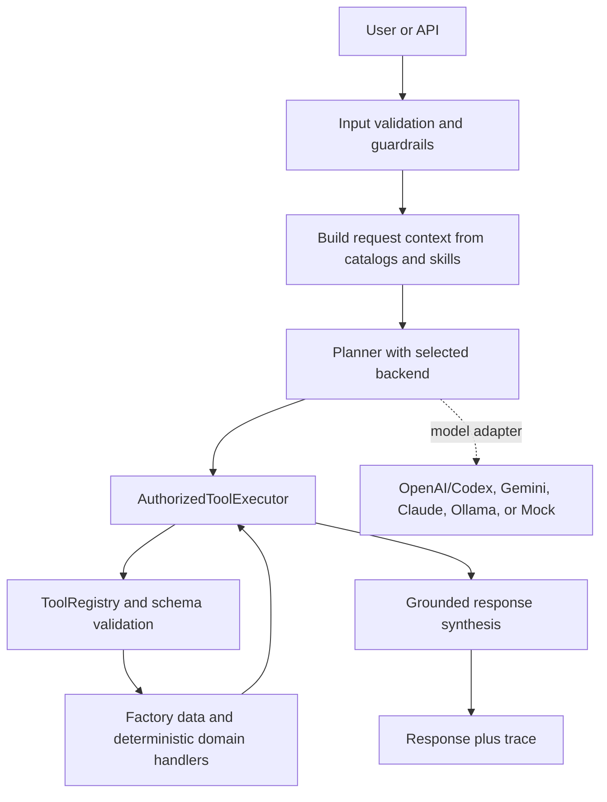

# Agent Foundation: Factory Operations Harness

This document adapts the architecture lessons from the supplied review to this repository. It is a responsibility map for the existing factory-operations agent, not a generic framework or a copy of another project's domain model.

## Design principle

The model interprets a request, proposes a plan, and explains verified results. Deterministic application code owns data access, calculations, validation, permissions, and execution. The same domain behavior must remain testable in `MOCK` mode without any model credentials.



Every tool proposal crosses `AuthorizedToolExecutor` before `ToolRegistry` can invoke a domain function. Provider selection changes the model adapter, not the data-access or authorization path.

## The 14 transferable concepts in this project

| # | Concept | Current project mapping | Status and limitation |
|---:|---|---|---|
| 1 | Data adapters | `factory-agent/data_access/csv_loader.py`, `loader.py`, `revision.py` | CSV is the current source adapter; schema-and-content revision IDs make each run reproducible, but there is no second production source adapter yet. |
| 2 | Canonical schema | `factory-agent/data_access/schema_validator.py` | Dataset contracts validate expected fields and constraints before domain use. |
| 3 | Validation | `factory-agent/data_access/schema_validator.py`, `factory-agent/agent/tool_registry.py` | Ingest validation and tool-argument validation are separate; errors block invalid work. |
| 4 | Manifest/configuration | `factory-agent/config/settings.py`, `factory-agent/skills/*/manifest.json` | Provider, paths, and skill metadata are configurable; config must continue to affect runtime behavior, not just documentation. |
| 5 | Strategy pattern | `factory-agent/skills/*/handler.py` | Domain handlers currently encode the factory rules directly. Add a strategy only when a real factory/tenant variation needs one. |
| 6 | Domain services | `factory-agent/skills/*/handler.py`, `factory-agent/tools/` | Python owns material sufficiency, machine requirements, risk calculations, and data queries. |
| 7 | Tool interface | `factory-agent/agent/tool_registry.py` | One registry defines the approved tools and their argument contracts. |
| 8 | Agent orchestration | `factory-agent/agent/harness.py`, `llm_first_planner.py`, `tool_executor.py` | The harness coordinates plan, authorization, execution, synthesis, and trace; tool calls are bounded. |
| 9 | Context engineering | `factory-agent/agent/context_builder.py`, `llm_first_planner.py` | Catalog-backed context exists. It currently loads skill catalog context broadly; request-specific retrieval and explicit data freshness/provenance can improve it. |
| 10 | Provider adapters | `factory-agent/models/` | OpenAI/Codex, Gemini, Claude, Ollama, and Mock implement `LLMBackend.generate`. Provider errors and event streams are not yet fully normalized. |
| 11 | Guardrails | `factory-agent/guardrails/`, `agent/tool_executor.py` | Input checks and a shared tool authorization boundary exist. Current data is a single local demo scope, not a multi-tenant authorization system. |
| 12 | State and memory | `factory-agent/agent/session_manager.py`, `wiki_manager.py` | Conversation sessions are in-memory; wiki knowledge is file-backed. Neither is a durable workflow store for multi-instance deployment. |
| 13 | Observability and evaluation | `factory-agent/agent/trace.py`, `factory-agent/evals/`, `factory-agent/tests/` | Per-run traces include the pinned data revision; behavioral cases, thresholds, CI, and offline regression tests are present. Offline Mock scores are not live-model quality claims. |
| 14 | Deployment and recovery | `.github/workflows/ci.yml`, `factory-agent/web_app.py` | CI and a FastAPI entry point exist. Production isolation, durable backups, health monitoring, and recovery procedures remain deployment work. |

## Data and model adapters are different boundaries

```text
Factory source (CSV today; other source later)
    -> source adapter
    -> validated factory records
    -> deterministic domain tools

Agent request
    -> selected model backend
    -> normalized ModelResponse
    -> planner proposal
    -> AuthorizedToolExecutor
```

Adding a database or ERP should change the data boundary while preserving the domain/tool contracts. Adding a model provider should change the provider adapter while preserving the planner, tools, and authorization rules. Do not treat a provider's tool-call format as permission to execute a tool.

## Canonical factory data contract

For every dataset, keep the contract explicit: required and optional fields, identifier keys, types and units, nullability, duplicate handling, and authoritative source. Do not invent a missing value to make a calculation succeed. A required identity or quantity error should stop the operation; optional omissions should be surfaced as a limitation where they affect the result.

At startup the data loader pins a content-derived revision over the configured CSVs and their executable schema definitions. The health/chat response reports that revision without exposing source rows. If a CSV changes while the process is running, the loader fails closed and requires a restart so cached tables cannot be mixed with a newer source snapshot. This detects drift; it does not retain private-data history or provide rollback. A deployment must keep approved, access-controlled snapshots separately.

If this demo becomes multi-factory or multi-tenant, add `tenant_id`, `source_id`, and provenance at ingestion, and derive the permitted scope from trusted server-side identity. Do not accept tenant or actor identity from model-generated arguments. The current `RunContext` is a demo context, not proof of tenant isolation.

## Seven design questions, answered for this agent

1. **Problem:** answer factory order, inventory, material-feasibility, and machine-requirement questions over the included dataset.
2. **Data source:** validated CSV files today; any next source needs an adapter into stable factory records.
3. **Contract:** schemas and data catalogs define structures and meanings; invalid records and tool arguments should fail closed.
4. **Model responsibility:** interpret intent, select approved tools, ask for missing identifiers, and synthesize explanations. Python performs arithmetic and business rules.
5. **Capabilities:** tools come from the registry, but each run's server-created `RunContext` is the authorization boundary.
6. **Failure behavior:** reject invalid plans/arguments, expose tool/provider failures as failures, and avoid retrying side effects. Current tools are read-only; transient-provider retry policy is future work.
7. **Quality evidence:** deterministic tests prove contracts and safety; JSONL evaluations exercise end-to-end task success, routing, orchestration, robustness, and safety. Live provider runs must be reported separately.

## Build roadmap

1. **Keep the local baseline trustworthy:** run unit/integration tests and the offline eval suite on every change; keep eval cases and thresholds reviewable.
2. **Strengthen provider contract:** normalize provider error categories, model/session metadata, and optional usage consistently; test adapters with mocked HTTP/SDK transports and avoid fake zero-usage values.
3. **Make context selective and inspectable:** select only catalogs/skills relevant to a request, include source freshness and limitations, and trace which context was actually supplied.
4. **Make data provenance explicit:** record source and load time for data; add a second adapter only when there is a concrete source to integrate; test both adapters against the same canonical records.
5. **Introduce policy only for real scope needs:** when multi-factory access is added, derive actor/tenant permissions server-side and test that scope changes are enforced by the data source, not just by prompts.
6. **Harden deployment before claiming production readiness:** define durable session/workflow storage, isolated secrets/config, health and failure monitoring, backup/restore, and recovery tests.

Do not add a database, plugin system, complex provider registry, or generalized strategy framework until a real requirement needs it. The project is a portfolio-quality agent harness, not a claim of production multi-tenant readiness.
